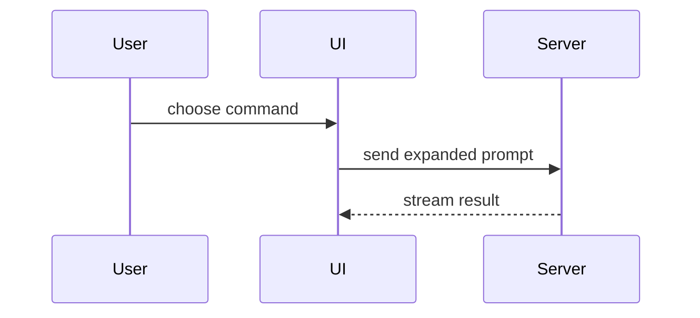

# Show me

Help the user understand the current topic of conversation visually. Skip the preamble and keep
prose brief. Pick the smallest view that makes the key point clear.

Adapted from humanlayer/skills `visual-pr/references/show-me.md` (MIT) — see
`~/.claude/skills/CREDITS.md`.

## Hard rules

- **Local only.** Output goes to the terminal or to a local file. Never push, comment, post to
  Slack/Linear/GitHub, or publish an Artifact from this skill. If the user wants to share the
  result, that's a separate, explicit request.
- **Ground it in the real code.** Read the files before drawing them. Use real names, paths,
  props and states from the codebase, not invented ones. If part of the picture is a guess,
  mark it (`?`) rather than drawing it with confidence.
- **Placeholder data only.** Examples, sample payloads and mock UI use made-up values, never
  real customer names, emails, phone numbers, message content, tokens or credentials, even if
  they appear in fixtures, logs or query results you read.

## Views

- Show logic or an algorithm as pseudocode:

```text
on(save)
  if content is unchanged
    return cached result
  write new content
  return fresh result
```

- Show runtime control flow as a call tree:

```text
submitForm
  createSession
    persistPrompt
    launchAgent
  navigateToSession
```

- Show UI structure as a component tree, including state and module boundaries that matter:

```tsx
<SessionPage> (apps/example/src/routes/session.tsx)
  useSessionEvents()
  <SessionToolbar>
    <RunSkillButton> (packages/ui)
```

- Show file responsibility or a broad refactor as a shallow file tree:

```text
src/
├── commands/       # parses user actions
├── sessions/       # owns session state
└── transport/      # sends API requests
```

- Show component interaction, control flow, or data flow with Mermaid. The terminal shows it as
  source, so keep it short enough to read as text. If it needs rendering to be readable, it
  belongs in the HTML page below instead.



- Use `diff` when the point is what changes and the surrounding shape already exists. Match the
  diff shape to the topic.

For a component change:

```diff
 <SessionPage>
   useSessionEvents()
   <SessionToolbar>
+    <RunSkillButton />
   <SessionTimeline>
+    <SkillResultCard />
```

For a file-layout change:

```diff
 src/
 ├── commands/
+│   └── show-me.ts       # expands the slash command
 ├── sessions/
-└── transport.ts
+└── transport/
+    ├── client.ts
+    └── stream.ts
```

For a call-tree or call-stack change:

```diff
 submitForm
   createSession
     persistPrompt
+    expandSkillMention
     launchAgent
-  navigateToSession
+  navigateToSession
+    subscribeToEvents
```

For a state or control-flow change:

```diff
 on(save)
-  write content
+  if content is unchanged
+    return cached result
+  write new content
+  invalidate cache
```

- Show the whole block when most of it is new, when omitted context would hide ownership or
  order, or when the user needs a copyable target shape:

```ts
function expandSkill(command: string): string {
  const skillName = command.slice(1)
  return `use the ${skillName} skill`
}
```

## Local HTML page

For a visual UI, layout, state comparison, or concept too dense for text, create **one** focused
HTML file:

- **Where:** the session scratchpad directory if the system prompt lists one, otherwise
  `${TMPDIR:-/tmp}/show-me/`. Name it `show-me-{short-description}.html`. Never write it into
  the repo's working tree.
- **Self-contained:** one file, all CSS and JS inline, SVG drawn by hand. No CDN scripts, web
  fonts, remote images or analytics, so it works offline and requests nothing from anywhere.
  (That rules out rendering Mermaid in the page; draw the diagram as inline SVG instead.)
- **Look:** match the product's colours, type, spacing and components where you know them; use
  real labels from the code with placeholder data; make it readable at desktop and phone width
  and in light and dark mode.
- **Open it** with `open {path}` and give the user the path.

## Layout

Place each visual next to the short text it supports. Keep only the calls, files, props, states,
and boundaries needed to answer the user's current question. One or two views usually beat five.
